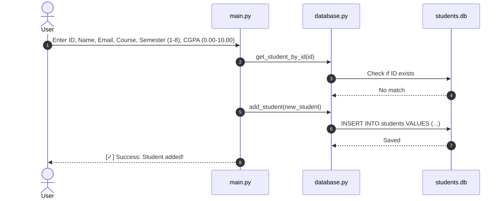

# Technical Implementation & Technologies Guide
## Student Record Management System (SRMS)

---

## Table of Contents
1. [Technologies Used & Why They Were Chosen](#1-technologies-used--why-they-were-chosen)
   - 1.1 Python 3
   - 1.2 SQLite3 Embedded Database
   - 1.3 Command-Line Interface (CLI)
   - 1.4 Why "Zero Third-Party Packages"?
2. [Code Structure & Design Patterns](#2-code-structure--design-patterns)
   - 2.1 Layered Architecture
   - 2.2 Data Access Object (DAO) Pattern
   - 2.3 Factory Method Pattern
   - 2.4 Safe Connection Handling with Context Managers
3. [Source Code Walkthrough](#3-source-code-walkthrough)
   - 3.1 `models.py` (The Student Model)
   - 3.2 `database.py` (Database Operations)
   - 3.3 `main.py` (User Interface & Flow Control)
4. [Key Algorithms & How They Work](#4-key-algorithms--how-they-work)
   - 4.1 Dynamic Table Column Width Formatting
   - 4.2 Non-Destructive Update (Keeping Current Values)
   - 4.3 Safe Input Prompters with Retry Loops
   - 4.4 Multi-Column Keyword Search with SQL `LIKE`
5. [Process Flow & Diagrams](#5-process-flow--diagrams)
   - 5.1 How Adding a Student Works
   - 5.2 How Updating a Student Works
6. [Security & Data Safety](#6-security--data-safety)
   - 6.1 Preventing SQL Injection
   - 6.2 Transaction Safety (Auto-Commit & Rollback)
   - 6.3 Clean Error Separation
7. [Technology Comparisons](#7-technology-comparisons)
   - 7.1 SQLite vs. Text/CSV/JSON Files
   - 7.2 SQLite vs. Server Databases (MySQL/PostgreSQL)

---

## 1. Technologies Used & Why They Were Chosen

```
+-------------------------------------------------------------------------+
| Technology                | Role in Project                             |
+-------------------------------------------------------------------------+
| Python 3 (3.6+)           | Core programming language                   |
| sqlite3 (Standard Library)| Embedded relational database engine         |
| sys (Standard Library)    | Clean program termination (`sys.exit`)      |
| Command Line (CLI)        | User interface and text formatting          |
| Storage (`students.db`)   | Single local database file on disk          |
+-------------------------------------------------------------------------+
```

### 1.1 Python 3
- **Why Python?** Python is easy to read, clean, and comes with comprehensive built-in tools.
- **Key Concepts Used:**
  - **Classes and Objects:** Used to model a `Student` and a `DatabaseManager`.
  - **Class Methods (`@classmethod`):** Used to build student objects directly from database rows.
  - **Custom Exceptions:** Used to cleanly alert the program when duplicate IDs occur.

### 1.2 SQLite3 Embedded Database
- **What is SQLite?** SQLite is a complete relational database engine contained in a lightweight C library that comes bundled with Python.
- **Why SQLite instead of MySQL or PostgreSQL?**
  - **No Server Setup:** You don't need to install a database server, configure user passwords, or open ports.
  - **Single Portable File:** All tables and data are saved into one file (`students.db`).
  - **ACID Compliant:** Ensures transactions are atomic and consistent—your data won't get corrupted if the app is closed unexpectedly.

### 1.3 Command-Line Interface (CLI)
- Uses standard Python inputs (`input()`) and outputs (`print()`).
- Works on Windows Command Prompt, PowerShell, macOS Terminal, and Linux Bash.

### 1.4 Why "Zero Third-Party Packages"?
This project deliberately uses **only Python's built-in standard library**.
- Anyone can clone the repository and run `python main.py` immediately without running `pip install`.
- No risk of broken dependencies or version conflicts over time.

---

## 2. Code Structure & Design Patterns

### 2.1 Layered Architecture
The project follows a clean 3-tier architecture:

1. **Presentation (`main.py`):** Handles menus, user typing, input validation, and prints the tables.
2. **Model (`models.py`):** Defines the `Student` class and its attributes.
3. **Data Access (`database.py`):** Speaks directly to SQLite using SQL statements.

Each file has one clear responsibility. If you want to change how the database works tomorrow, you only change `database.py`.

### 2.2 Data Access Object (DAO) Pattern
The `DatabaseManager` class acts as a single gateway for all database actions. The user interface (`main.py`) never writes raw SQL. Instead, it calls simple methods like:
- `db.add_student(...)`
- `db.get_all_students()`
- `db.search_students(...)`
- `db.update_student(...)`
- `db.delete_student(...)`

### 2.3 Factory Method Pattern
In `models.py`, the method `Student.from_row(row)` converts a raw database tuple:
```python
("S101", "Asha Nair", "asha@example.com", "Computer Science", 3, 8.75)
```
into an initialized `Student` object. This keeps the rest of the application working with clean object properties (`student.name`, `student.cgpa`) rather than remembering list indexes (`row[1]`, `row[5]`).

### 2.4 Safe Connection Handling with Context Managers
Database queries use Python's `with` statement:
```python
with self._get_connection() as conn:
    cursor = conn.cursor()
    cursor.execute(...)
    conn.commit()
```
This guarantees that database connections and file locks are closed automatically as soon as the operation finishes, preventing file lock errors.

---

## 3. Source Code Walkthrough

### 3.1 `models.py` (The Student Model)

```python
class Student:
    """Represents an individual student record."""

    def __init__(self, student_id, name, email, course, semester, cgpa):
        self.student_id = str(student_id).strip()
        self.name = str(name).strip()
        self.email = str(email).strip()
        self.course = str(course).strip()
        self.semester = int(semester)
        self.cgpa = float(cgpa)
```
- **`.strip()`:** Removes accidental spaces at the start or end of names, IDs, and emails.
- **`int()` & `float()`:** Converts semester (1–8) and CGPA (0.00–10.00) to their true numeric types.

#### Helper Methods:
- `Student.from_row(row)`: Takes a tuple returned by SQLite and returns a `Student` object.
- `student.to_tuple()`: Converts a `Student` object back into a tuple so it can be passed directly to SQL `INSERT` statements.
- `__str__()`: Gives a friendly string representation useful for debugging.

---

### 3.2 `database.py` (Database Operations)

#### 1. Custom Exception for Duplicate IDs
```python
class DuplicateStudentError(Exception):
    """Raised when trying to add a student ID that already exists."""
    pass
```
When an existing ID is entered, raising this custom error allows `main.py` to display a helpful error message instead of an unreadable SQLite crash.

#### 2. Automatic Table Creation & Migration
```python
def init_db(self):
    with self._get_connection() as conn:
        cursor = conn.cursor()
        cursor.execute(
            """
            CREATE TABLE IF NOT EXISTS students (
                student_id TEXT PRIMARY KEY,
                name TEXT NOT NULL,
                email TEXT NOT NULL,
                course TEXT NOT NULL,
                semester INTEGER NOT NULL,
                cgpa REAL NOT NULL
            )
            """
        )
        # Automatic column migration if existing DB used 'gpa'
        cursor.execute("PRAGMA table_info(students)")
        existing_columns = [col[1] for col in cursor.fetchall()]
        if "gpa" in existing_columns and "cgpa" not in existing_columns:
            cursor.execute("ALTER TABLE students RENAME COLUMN gpa TO cgpa")
        conn.commit()
```
Runs when `DatabaseManager` is instantiated. `IF NOT EXISTS` ensures that existing records are never wiped when starting the program, and existing `gpa` columns are seamlessly upgraded to `cgpa`.

#### 3. Parameterized INSERT Query
```python
def add_student(self, student):
    with self._get_connection() as conn:
        cursor = conn.cursor()
        try:
            cursor.execute(
                """
                INSERT INTO students (student_id, name, email, course, semester, cgpa)
                VALUES (?, ?, ?, ?, ?, ?)
                """,
                student.to_tuple(),
            )
            conn.commit()
        except sqlite3.IntegrityError:
            raise DuplicateStudentError(
                f"A student with ID '{student.student_id}' already exists."
            )
```
Uses `?` placeholders for security (see Section 6.1).

#### 4. Multi-Field Search Query
```python
def search_students(self, keyword):
    pattern = f"%{str(keyword).strip()}%"
    with self._get_connection() as conn:
        cursor = conn.cursor()
        cursor.execute(
            """
            SELECT student_id, name, email, course, semester, cgpa
            FROM students
            WHERE student_id LIKE ? OR name LIKE ? OR course LIKE ?
            ORDER BY student_id ASC
            """,
            (pattern, pattern, pattern),
        )
        rows = cursor.fetchall()
        return [Student.from_row(row) for row in rows]
```
The `%` wildcards let the user match any part of an ID, student name, or course.

---

### 3.3 `main.py` (User Interface & Flow Control)

#### Safe Input Prompters
Instead of basic `input()` calls that crash if the user enters a letter instead of a number, `main.py` uses 3 robust helper functions:
1. **`prompt_non_empty(prompt_text, default=None)`:** Loops until the user enters non-whitespace text.
2. **`prompt_int(prompt_text, min_val, max_val, default=None)`:** Catches `ValueError` if text is typed, and checks if the integer is within allowed range (e.g., 1 to 8).
3. **`prompt_float(prompt_text, min_val, max_val, default=None)`:** Checks that decimal numbers fall within allowed boundaries (e.g., 0.00 to 10.00).

---

## 4. Key Algorithms & How They Work

### 4.1 Dynamic Table Column Width Formatting
In a command-line interface, static column widths can make long names get cut off, or short columns take up too much empty space.

SRMS solves this with a dynamic width rule:
> **Column Width** = The length of the longest piece of text in that column, or the minimum header width (whichever is larger).

```python
col_id = max(max(len(s.student_id) for s in students), 10)
col_name = max(max(len(s.name) for s in students), 16)
col_email = max(max(len(s.email) for s in students), 22)
col_course = max(max(len(s.course) for s in students), 16)
col_sem = 8
col_cgpa = 6
```
Once the widths are determined, the table builds its horizontal border using string multiplication:
```python
separator = f"+-{'-' * col_id}-+-{'-' * col_name}-+-{'-' * col_email}-+-{'-' * col_course}-+-{'-' * col_sem}-+-{'-' * col_cgpa}-+"
```
Text columns are left-aligned using `.ljust(col_width)` and numerical columns are centered using `.center(col_width)`.

### 4.2 Non-Destructive Update (Keeping Current Values)
When updating a student's profile, users often want to change just one field (like CGPA) without retyping their entire name and email.

This is solved with the `default` parameter in input prompts:
```python
user_input = input(f"{prompt_text} [{default}]: ").strip()
if not user_input:
    return default
```
If the user presses `[Enter]`, the original value is preserved. If they type something new, the new value is used.

### 4.3 Safe Input Prompters with Retry Loops
To make sure typos never crash the application, every prompt runs inside a `while True:` loop:
- If valid: returns the clean value.
- If invalid: prints a clear explanation and immediately asks again.

### 4.4 Multi-Column Keyword Search with SQL `LIKE`
Rather than making the user specify "Search by Name" or "Search by Course", the keyword search runs:
```sql
WHERE student_id LIKE ? OR name LIKE ? OR course LIKE ?
```
with `%keyword%`. This means a single search box matches everything seamlessly.

---

## 5. Process Flow & Diagrams

### 5.1 How Adding a Student Works



### 5.2 How Updating a Student Works

```mermaid
sequenceDiagram
    autonumber
    actor User as User
    participant Main as main.py
    participant DB as database.py
    participant SQLite as students.db

    User->>Main: Enter Student ID to update
    Main->>DB: get_student_by_id(id)
    DB->>SQLite: SELECT * FROM students WHERE student_id = ?
    SQLite-->>DB: Row data
    DB-->>Main: Returns Student object
    Main->>User: Shows current values; press Enter to keep
    User->>Main: Changes CGPA, presses Enter on other fields
    Main->>DB: update_student(updated_student)
    DB->>SQLite: UPDATE students SET ...
    SQLite-->>DB: Success
    Main-->>User: [✓] Success: Record updated!
```

---

## 6. Security & Data Safety

### 6.1 Preventing SQL Injection
**What is SQL Injection?** If user input is directly inserted into an SQL string:
```python
# DANGEROUS: NEVER DO THIS
cursor.execute(f"SELECT * FROM students WHERE student_id = '{user_input}'")
```
An attacker could type `' OR '1'='1` and corrupt or access protected data.

**How SRMS prevents this:**
Every single query in `database.py` uses parameterized queries with `?`:
```python
cursor.execute("SELECT * FROM students WHERE student_id = ?", (student_id,))
```
SQLite automatically escapes all inputs and treats them strictly as plain text, eliminating SQL injection risk.

### 6.2 Transaction Safety (Auto-Commit & Rollback)
Using the connection context manager (`with self._get_connection() as conn:`):
- Changes are committed safely with `conn.commit()`.
- If an unexpected error happens during an operation, changes are rolled back automatically to keep `students.db` consistent.

### 6.3 Clean Error Separation
Low-level database errors are caught inside `database.py` and converted to application-level exceptions:
- `sqlite3.IntegrityError` -> `DuplicateStudentError`
This keeps `main.py` clean and user-friendly.

---

## 7. Technology Comparisons

### 7.1 SQLite vs. Text/CSV/JSON Files

| Feature | Text / CSV / JSON File | SQLite Database (`students.db`) |
|---|---|---|
| **Data Safety** | High risk of file corruption if closed mid-write | ACID-compliant; safe from power loss |
| **Duplicates** | Code must manually scan the whole file | Enforced automatically by `PRIMARY KEY` |
| **Search Speed** | Linear search (scans every line) | Fast indexed lookup (B-Tree) |
| **Setup Needed** | None | None (built into Python) |

### 7.2 SQLite vs. Server Databases (MySQL/PostgreSQL)

| Feature | MySQL / PostgreSQL | SQLite (This Project) |
|---|---|---|
| **Server Setup** | Requires separate service/daemon running | No server; runs inside Python process |
| **Portability** | Requires exporting/importing SQL dumps | Entire database is one portable file |
| **Ideal For** | Large websites with hundreds of users | Local tools, desktop apps, and mini-projects |
| **Memory Footprint** | Hundreds of megabytes | Under 1 MB |
