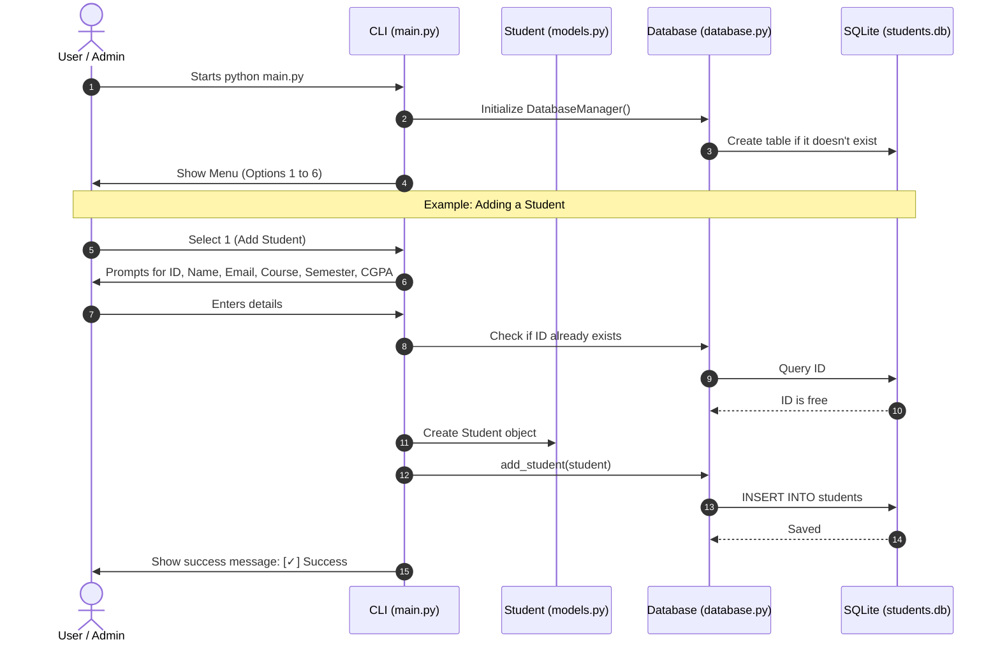
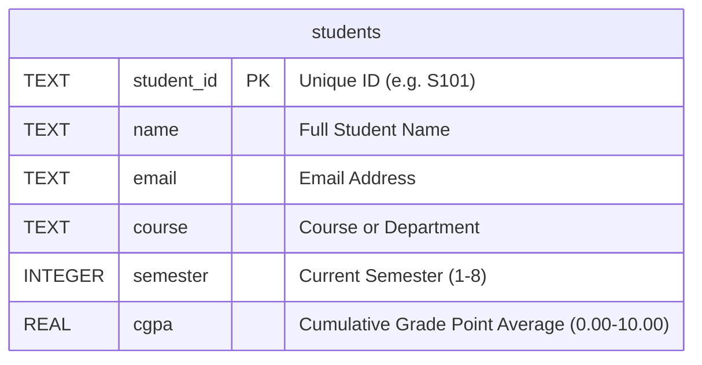
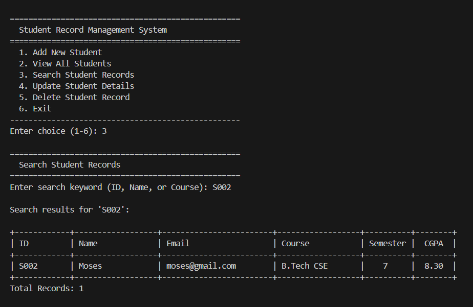
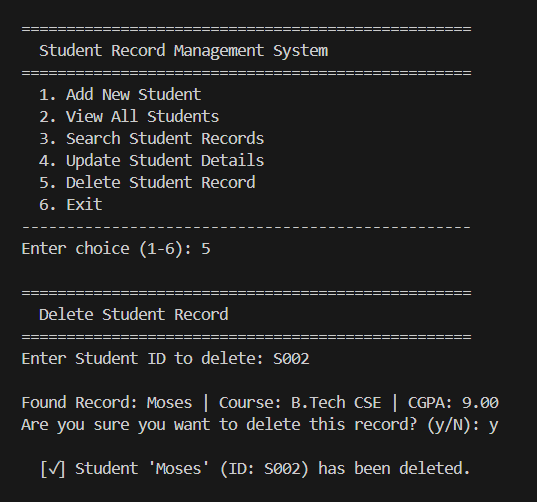
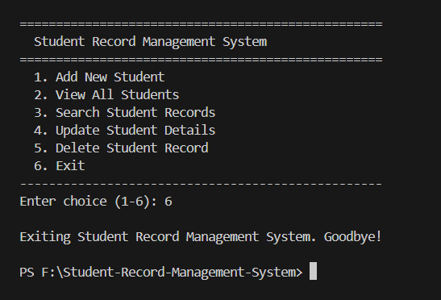

# Student Record Management System (SRMS)
## Project Documentation & User Guide

---

## Table of Contents
1. [Project Overview](#1-project-overview)
   - 1.1 Summary
   - 1.2 Problem Statement
   - 1.3 Solution & Key Goals
2. [System Architecture](#2-system-architecture)
   - 2.1 Three-Layer Design
   - 2.2 Project Structure & File Roles
   - 2.3 System Flow Diagram
3. [Features & Functionality](#3-features--functionality)
   - 3.1 Add New Student (Create)
   - 3.2 View All Students (Read)
   - 3.3 Search Student Records (Filter)
   - 3.4 Update Student Record (Update)
   - 3.5 Delete Student Record (Delete)
   - 3.6 Exit Program
4. [Database Design](#4-database-design)
   - 4.1 Schema Overview
   - 4.2 Data Fields & Constraints
   - 4.3 SQL Table Definition
5. [System Requirements](#5-system-requirements)
6. [Installation & How to Run](#6-installation--how-to-run)
7. [Step-by-Step User Walkthrough](#7-step-by-step-user-walkthrough)
   - 7.1 Main Menu
   - 7.2 Adding a Student
   - 7.3 Viewing the Records Table
   - 7.4 Searching for a Student
   - 7.5 Updating a Record (Keep Existing Values)
   - 7.6 Deleting a Record with Confirmation
8. [Input Validation & Error Prevention](#8-input-validation--error-prevention)
9. [Error Handling & Edge Cases](#9-error-handling--edge-cases)
10. [Future Scope](#10-future-scope)

---

## 1. Project Overview

### 1.1 Summary
The **Student Record Management System (SRMS)** is a simple, easy-to-use command-line application for storing and managing student academic details. It is written in Python 3 and uses an embedded SQLite database (`students.db`). 

It requires **no external packages** (`pip install` is not needed) and runs on Windows, macOS, and Linux out of the box.

### 1.2 Problem Statement
Keeping student records in manual spreadsheets or loose text files often causes:
- Accidental file corruption or lost records.
- Duplicate student roll numbers / IDs.
- Invalid entries (like negative semesters or out-of-range CGPAs).
- Messy, misaligned data.

On the other hand, full-scale enterprise school software is often too heavy, expensive, and complex for small departments, projects, or offline use.

### 1.3 Solution & Key Goals
SRMS provides a simple, reliable desktop command-line tool with:
- **Zero setup:** Works immediately with any standard Python installation.
- **Safe storage:** Saves data directly to a local SQLite database with unique IDs.
- **Input checking:** Automatically rejects empty inputs, duplicate IDs, semesters outside 1–8, and CGPAs outside 0.00–10.00.
- **Clean output:** Neatly displays records in auto-aligned tables in your terminal.
- **Modular code:** Easy to understand, maintain, and expand.

---

## 2. System Architecture

### 2.1 Three-Layer Design
The project separates user interface logic, data definitions, and database queries into three clean layers:

```
+-----------------------------------------------------------+
|                   Presentation Layer                      |
|                        (main.py)                          |
|  - Displays menus and prompts                             |
|  - Validates user input before sending to database        |
|  - Renders data in clean ASCII tables                     |
+-----------------------------+-----------------------------+
                              |
                              v
+-----------------------------------------------------------+
|                      Domain Model                         |
|                       (models.py)                         |
|  - Defines the Student object                             |
|  - Converts database rows to Python objects               |
+-----------------------------+-----------------------------+
                              |
                              v
+-----------------------------------------------------------+
|                    Data Access Layer                      |
|                      (database.py)                        |
|  - Runs SQL queries (INSERT, SELECT, UPDATE, DELETE)      |
|  - Manages SQLite connection and database file            |
+-----------------------------+-----------------------------+
                              |
                              v
+-----------------------------------------------------------+
|                   SQLite Database File                    |
|                       (students.db)                       |
+-----------------------------------------------------------+
```

### 2.2 Project Structure & File Roles

| File | What It Does |
|---|---|
| `main.py` | Runs the main menu loop, handles keyboard inputs, validates data, and displays results. |
| `database.py` | Connects to SQLite (`students.db`), runs queries safely with parameters, and handles duplicate errors. |
| `models.py` | Holds the `Student` class. Contains helper methods to convert between database rows and Python objects. |
| `README.md` | Quick setup and basic guide for GitHub or new users. |
| `PROJECT_DOCUMENTATION.md` | Full system specifications, requirements, and user manual. |
| `IMPLEMENTATION_AND_TECHNOLOGIES.md` | Technical code walkthrough and explanation of technologies. |

### 2.3 System Flow Diagram



---

## 3. Features & Functionality

### 3.1 Add New Student (Create)
- Asks for: Student ID, Full Name, Email, Course/Major, Semester, and CGPA.
- Checks if the ID already exists before prompting for remaining details.
- Validates that text is not blank, semester is between 1 and 8, and CGPA is between 0.00 and 10.00.
- Saves the student to the database.

### 3.2 View All Students (Read)
- Retrieves all stored students sorted by Student ID in ascending order.
- Calculates column widths dynamically so text is never cut off.
- Prints a clean table with headers, row borders, and a total count.

### 3.3 Search Student Records (Filter)
- Lets you search using any single keyword.
- Matches against three fields simultaneously: **Student ID**, **Student Name**, or **Course**.
- Shows all matching records in the formatted table.

### 3.4 Update Student Record (Update)
- Asks for the Student ID you want to modify.
- Displays the student's current values.
- **Convenient Defaulting:** You can press `[Enter]` on any field to keep its existing value, or type a new value to replace it.
- Applies all standard validation checks on any newly entered data (Semester 1–8, CGPA 0.00–10.00).

### 3.5 Delete Student Record (Delete)
- Asks for the Student ID to remove.
- Shows the student's name, course, and CGPA so you can double-check.
- Requires explicit confirmation (`y` or `yes`). Typing anything else safely cancels the deletion.

### 3.6 Exit Program
- Cleanly closes the application upon choosing option 6 without leaving unfinished locks on the database.

---

## 4. Database Design

### 4.1 Schema Overview
The database uses a single relational table called `students` stored in `students.db`.



### 4.2 Data Fields & Constraints

| Column Name | SQLite Type | Constraints | Description |
|---|---|---|---|
| `student_id` | `TEXT` | `PRIMARY KEY`, `NOT NULL` | Unique identifier (e.g., "S101") |
| `name` | `TEXT` | `NOT NULL` | Student's full name |
| `email` | `TEXT` | `NOT NULL` | Email address |
| `course` | `TEXT` | `NOT NULL` | Enrolled course or major |
| `semester` | `INTEGER` | `NOT NULL` | Semester number (1 to 8) |
| `cgpa` | `REAL` | `NOT NULL` | Cumulative GPA on a 10-point scale (0.00 to 10.00) |

### 4.3 SQL Table Definition
```sql
CREATE TABLE IF NOT EXISTS students (
    student_id TEXT PRIMARY KEY,
    name       TEXT NOT NULL,
    email      TEXT NOT NULL,
    course     TEXT NOT NULL,
    semester   INTEGER NOT NULL,
    cgpa       REAL NOT NULL
);
```

---

## 5. System Requirements

- **Operating System:** Windows, macOS, or Linux.
- **Python Version:** Python 3.6 or newer (Python 3.8+ recommended).
- **External Dependencies:** **None** (uses only Python standard library: `sqlite3` and `sys`).
- **Disk Space:** Less than 5 MB.

---

## 6. Installation & How to Run

1. **Clone or Download the Project:**
   ```bash
   git clone https://github.com/FibinDv/Student-Record-Management-System.git
   cd Student-Record-Management-System
   ```

2. **Verify Python is installed:**
   ```bash
   python --version
   ```

3. **Run the program:**
   ```bash
   python main.py
   ```
   *(On first run, the database file `students.db` is created automatically in the same folder.)*

---

## 7. Step-by-Step User Walkthrough

### 7.1 Main Menu
When launched, the program greets you with a simple numerical menu:


```text
==================================================
  Student Record Management System
==================================================
  1. Add New Student
  2. View All Students
  3. Search Student Records
  4. Update Student Details
  5. Delete Student Record
  6. Exit
--------------------------------------------------
Enter choice (1-6): 
```

### 7.2 Adding a Student


```text
==================================================
  Add New Student
==================================================
Enter Student ID (e.g. S101): S101
Enter Full Name: Asha Nair
Enter Email Address: asha@example.com
Enter Course / Major: Computer Science
Enter Current Semester (1-8): 3
Enter CGPA (0.00 to 10.00): 8.75

  [✓] Success: Student 'Asha Nair' (ID: S101) has been added.
```

### 7.3 Viewing the Records Table


```text
==================================================
  All Student Records
==================================================

+------------+-----------+------------------+------------------+----------+--------+
| ID         | Name      | Email            | Course           | Semester |  CGPA  |
+------------+-----------+------------------+------------------+----------+--------+
| S101       | Asha Nair | asha@example.com | Computer Science |    3     |  8.75  |
+------------+-----------+------------------+------------------+----------+--------+
Total Records: 1
```

### 7.4 Searching for a Student
You can search by ID, Name, or Course keyword:



```text
==================================================
  Search Student Records
==================================================
Enter search keyword (ID, Name, or Course): Science

Search results for 'Science':

+------------+-----------+------------------+------------------+----------+--------+
| ID         | Name      | Email            | Course           | Semester |  CGPA  |
+------------+-----------+------------------+------------------+----------+--------+
| S101       | Asha Nair | asha@example.com | Computer Science |    3     |  8.75  |
+------------+-----------+------------------+------------------+----------+--------+
Total Records: 1
```

### 7.5 Updating a Record (Keep Existing Values)
Press `[Enter]` to keep an existing value, or type new data:


```text
==================================================
  Update Student Record
==================================================
Enter Student ID to update: S101

Editing Student: Asha Nair (S101)
Press [Enter] to keep current value, or type a new value:
Full Name [Asha Nair]: 
Email [asha@example.com]: 
Course [Computer Science]: Software Engineering
Semester [3]: 4
CGPA [8.75]: 9.10

  [✓] Success: Record for Student ID 'S101' has been updated.
```

### 7.6 Deleting a Record with Confirmation


```text
==================================================
  Delete Student Record
==================================================
Enter Student ID to delete: S101

Found Record: Asha Nair | Course: Software Engineering | CGPA: 9.10
Are you sure you want to delete this record? (y/N): y

  [✓] Student 'Asha Nair' (ID: S101) has been deleted.
```

### 7.7 Exiting the Application


```text
Exiting Student Record Management System. Goodbye!
```

---

## 8. Input Validation & Error Prevention

To make sure the database remains clean, the application includes built-in safeguards:

1. **Non-Empty Text:** You cannot leave fields blank. The program asks again if you just press space or Enter on mandatory fields.
2. **Semester Range Check:** Must be a whole number from 1 to 8.
3. **CGPA Range Check:** Must be a decimal number from 0.00 to 10.00.
4. **Duplicate ID Prevention:** You cannot add a student ID that is already in use.
5. **Deletion Safety:** Deletions require typing `y` or `yes`. Any other key cancels the operation.

---

## 9. Error Handling & Edge Cases

| Situation | What the Application Does |
|---|---|
| User types letters for Semester or CGPA | Shows `Please enter a valid number` and asks again. |
| User enters a number out of range | Shows `Value must be at least...` or `cannot exceed...` and asks again. |
| Student ID not found on update or delete | Shows `No student found with ID '...'` and returns safely to menu. |
| User cancels delete | Shows `Deletion cancelled` and leaves the record unchanged. |
| Database empty when viewing | Shows `No student records found` without throwing errors. |

---

## 10. Future Scope

If you want to extend this project in the future, good next steps are:
- Add email format checking using regular expressions (`@` and `.com`).
- Add an option to export records to a `.csv` file.
- Add column sorting (e.g., sort by highest CGPA).
- Build a simple graphical user interface (GUI) using Tkinter or web interface with Flask.
