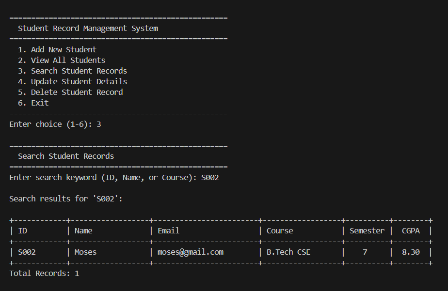
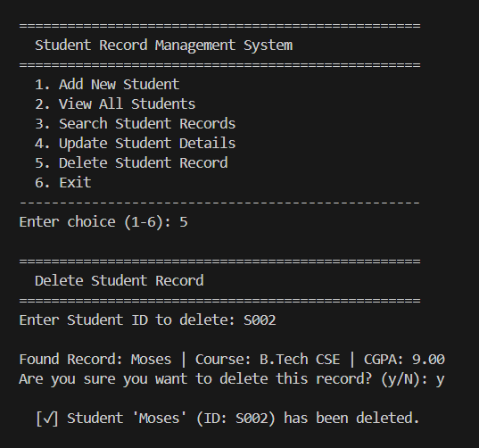
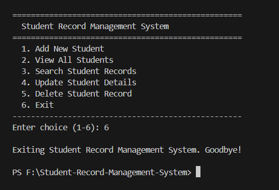

# Student Record Management System

A simple command-line mini project for managing student records. It is written in Python and stores everything in a local SQLite database.

## Features

- **Add** a new student (ID, name, email, course, semester, CGPA)
- **View** all students in a neatly aligned table
- **Search** by student ID, name, or course
- **Update** a student's details (press Enter to keep the current value)
- **Delete** a student, with a confirmation prompt
- Input validation: required fields, semester between 1 and 8, CGPA between 0.00 and 10.00
- Duplicate student IDs are rejected

## Requirements

- Python 3.6 or newer (uses only the standard library: `sqlite3` and `sys`)

## Getting Started

```bash
git clone https://github.com/FibinDv/Student-Record-Management-System.git
cd Student-Record-Management-System
python main.py
```

On first run, the app creates a `students.db` file in the same folder.

## Screenshots & Output

### 1. Main Menu


### 2. Adding a New Student


### 3. Viewing All Students


### 4. Searching Records


### 5. Updating a Student Record


### 6. Deleting a Record


### 7. Exiting the Application


## Project Structure

```
.
├── Output/                          # Program output screenshots
│   ├── Main Menu.PNG
│   ├── Additiion Of Student.PNG
│   ├── Viewing All Students.PNG
│   ├── Searching.PNG
│   ├── Update Record.PNG
│   ├── Deletion.PNG
│   └── Exit.PNG
├── main.py                          # Command-line interface and menu loop
├── database.py                      # SQLite database operations (DatabaseManager)
├── models.py                        # Student data model
├── README.md                        # Quick project overview and run instructions
├── PROJECT_DOCUMENTATION.md         # Detailed project guide, requirements, and user manual
└── IMPLEMENTATION_AND_TECHNOLOGIES.md # Code walkthrough and technology stack explanation
```

| File / Folder | Purpose |
|---------------|---------|
| `Output/` | Visual screenshots demonstrating CLI outputs for all operations |
| `main.py` | Shows the menu, reads user input, validates it, and prints formatted results |
| `database.py` | Creates the `students` table and handles add, get, list, search, update, and delete |
| `models.py` | Defines the `Student` class and converts it to and from database rows |
| `PROJECT_DOCUMENTATION.md` | Full system specification, features breakdown, and step-by-step user guide |
| `IMPLEMENTATION_AND_TECHNOLOGIES.md` | In-depth code walkthrough, architecture patterns, and tech stack details |

## Database Schema

Table: `students`

| Column | Type | Notes |
|--------|------|-------|
| `student_id` | TEXT | Primary key |
| `name` | TEXT | Required |
| `email` | TEXT | Required |
| `course` | TEXT | Required |
| `semester` | INTEGER | Required (1 to 8) |
| `cgpa` | REAL | Required (0.00 to 10.00) |

## License

This project is open for learning and personal use.
